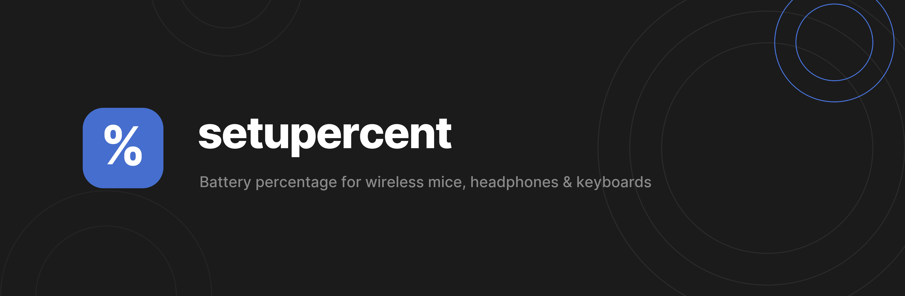
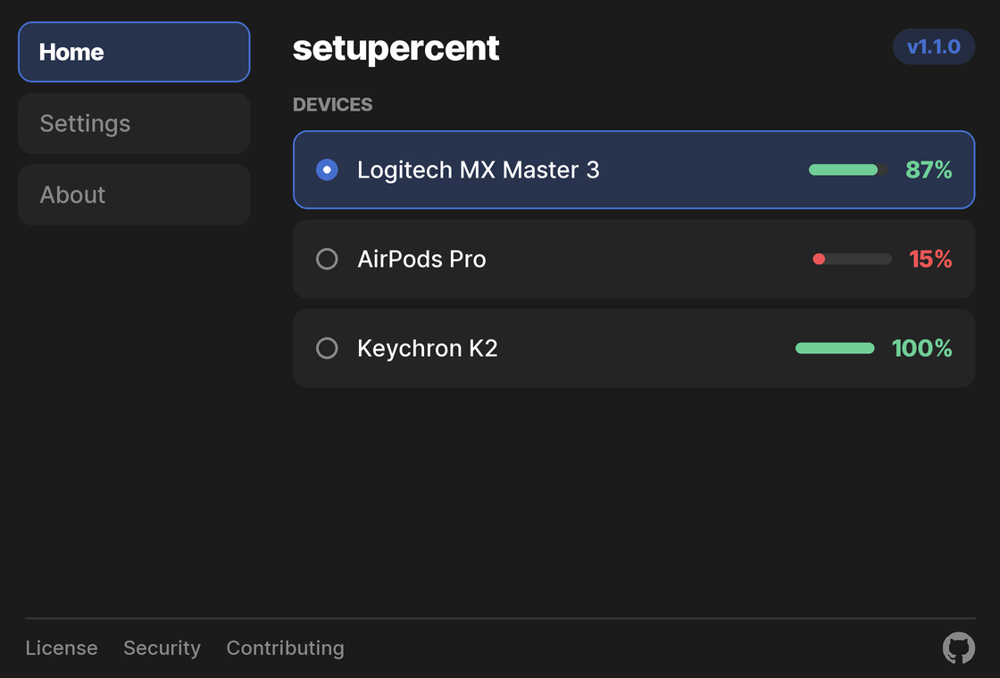
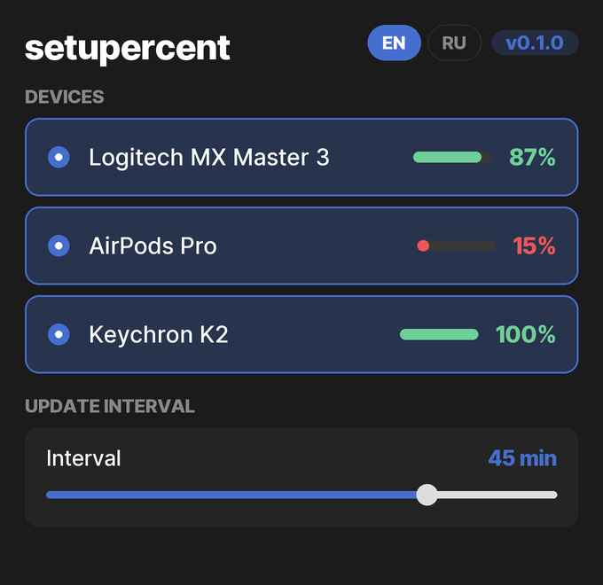
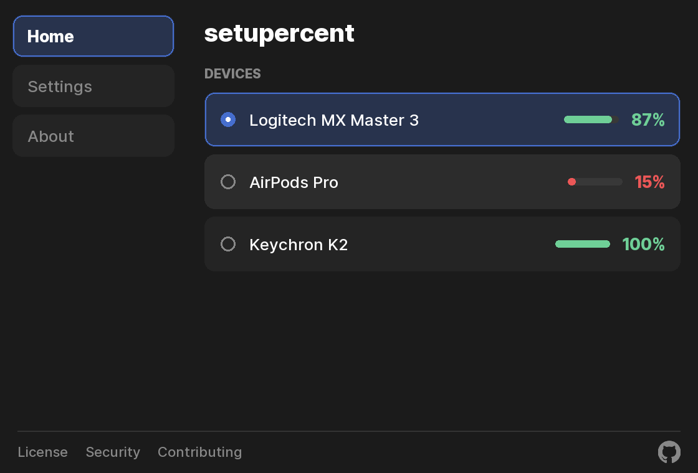
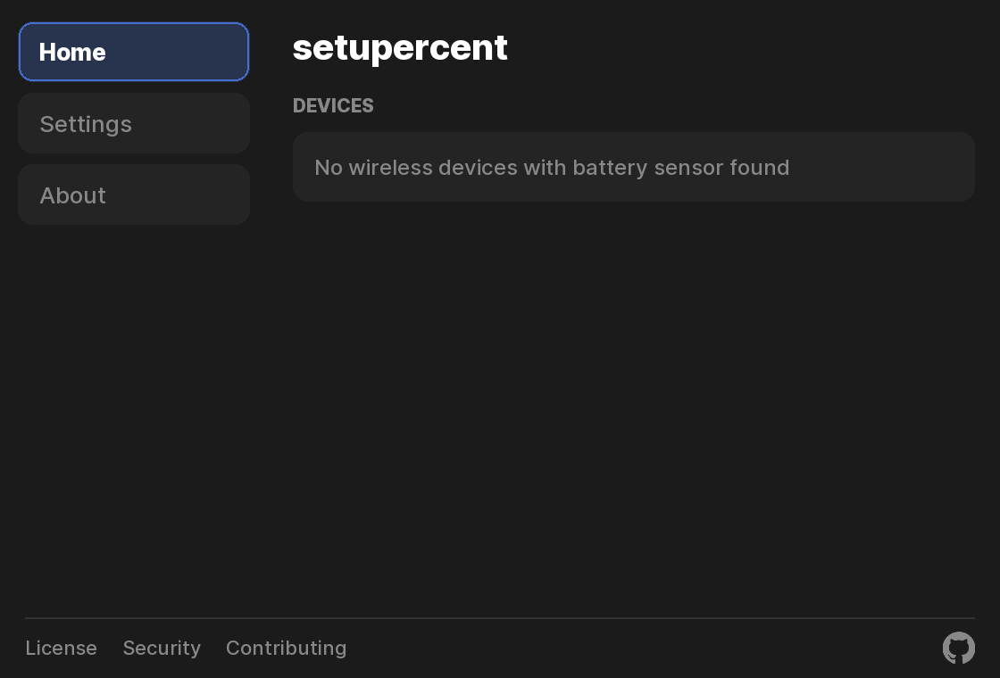
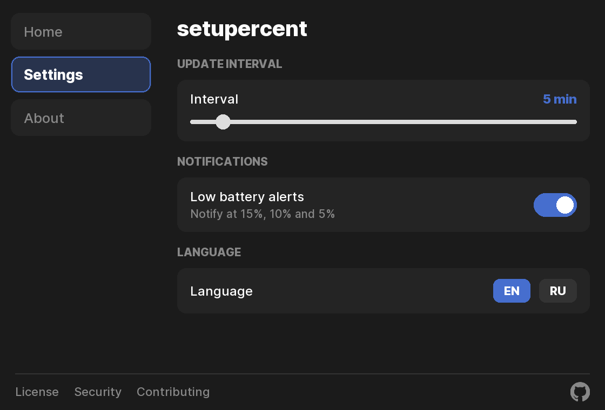
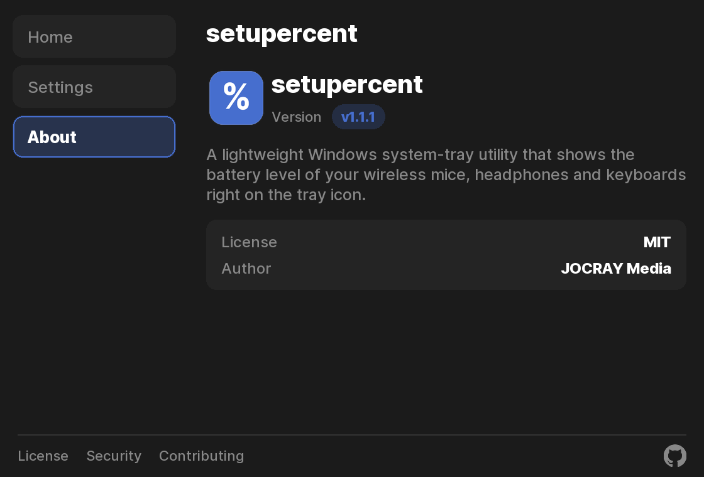
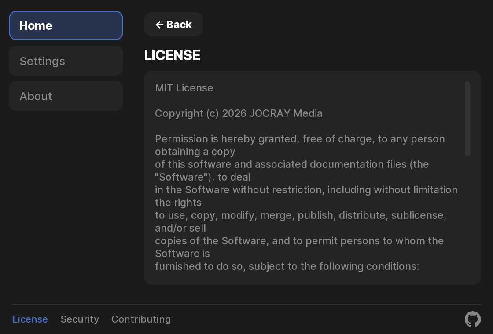

  

  
  

A Windows system-tray utility that keeps the battery level of your 
wireless mice, headphones, and keyboards right where you need it.

## Why it exists

Wireless mice die at the worst possible moment. Headphones run out mid-call. Keyboards disconnect while you're typing. Windows only shows battery levels for these devices in Bluetooth settings — and even then, not always and not for everything.

setupercent fixes that: it puts the battery percentage right in the system tray and keeps it up to date in the background. One glance at the taskbar and you know when it's time to charge.

## What it looks like

  

<em>A device is selected — its battery shows up in the tray</em>

  

<em>Track several devices at once and switch between them</em>

  

<em>Cards highlight on hover, so you always see what you're about to pick</em>

  

<em>No compatible devices yet — the Home tab tells you right away</em>

  

<em>Refresh interval, low-battery alerts and interface language in Settings</em>

  

<em>Version, license and credits on the About tab</em>

  

<em>License, Security and Contributing open inside the app — no browser needed</em>

## What it does

- **Battery in the tray** — the number lives right on the icon, always visible, no extra clicks.
- **Works with any wireless device** that reports battery to the system: mice, headphones, keyboards, gamepads.
- **Multiple devices** — pick the ones you care about from a list and switch between them.
- **Low-battery alerts** — native Windows notifications at 15%, 10% and 5%. Each threshold fires once per discharge cycle and resets after the device charges above 15%. Toggle them on or off in Settings.
- **Clean sidebar navigation** — switch effortlessly between Home, Settings, and About tabs.
- **Built-in documents** — License, Security and Contributing open right inside the window with a back button and scrollable text.
- **Configurable interval** — from 1 to 60 minutes, so the system isn't polled needlessly.
- **Runs quietly** — the window hides to the tray when closed, nothing floats on top of your other windows.
- **English and Russian** — switch languages with one click in the Settings tab.
- **Lightweight** — about 2 MB, no frameworks, no WebView, barely uses any memory.

## How to use

1. Launch `setupercent.exe` — the window opens right away, the tray icon appears.
2. Tick the devices you want to keep an eye on in the Home tab.
3. Open Settings to set a refresh interval (e.g. 5 minutes), toggle low-battery alerts and choose your language.
4. Close the window. It tucks into the tray, and the battery percentage keeps updating in the background.
5. To bring the window back, click the tray icon. To quit, use the tray icon's context menu.

## Installation

Grab the latest version from the [Releases](https://github.com/jocray/setupercent/releases) page and run it — no installation needed. Settings are saved automatically without creating any extra files next to the `.exe`: on NTFS they live in an alternate data stream of the executable itself, and on drives without ADS support (FAT32/exFAT) they fall back to `%APPDATA%\setupercent`.

## Requirements

- Windows 10 or 11 (x64)
- A device that reports its battery level through the standard Windows interface (most modern Bluetooth mice, headphones, and keyboards)

## Source code

The project is open — source, build instructions, and the full version history live in the [GitHub repository](https://github.com/jocray/setupercent). The README previews are generated by `generate_previews.py` (Pillow). Found a bug or have an idea? Open an issue.