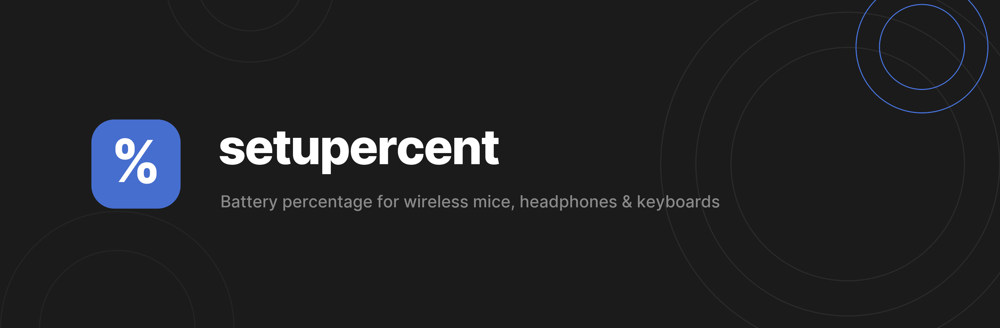
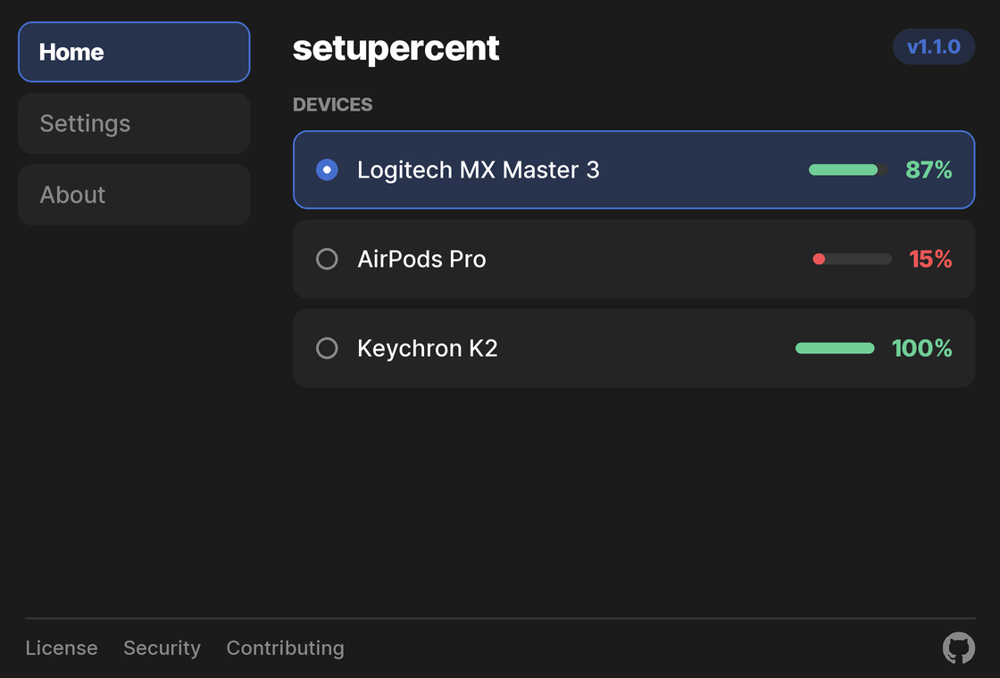
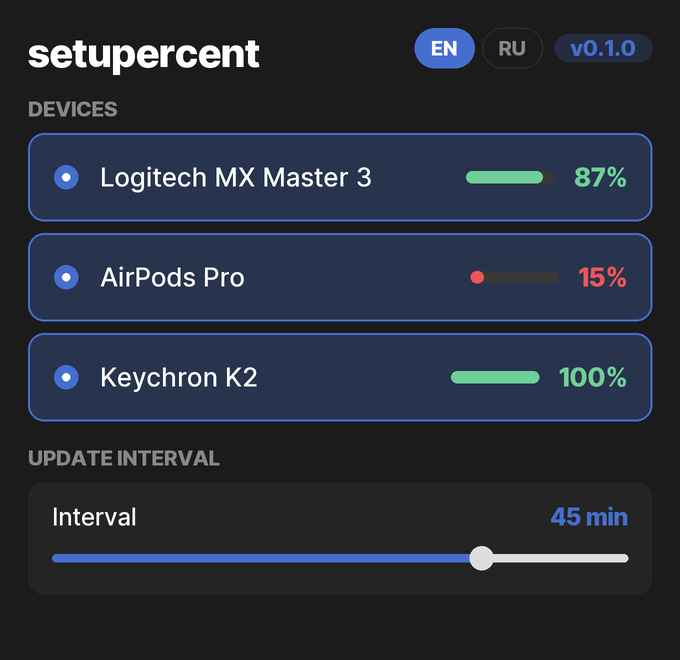
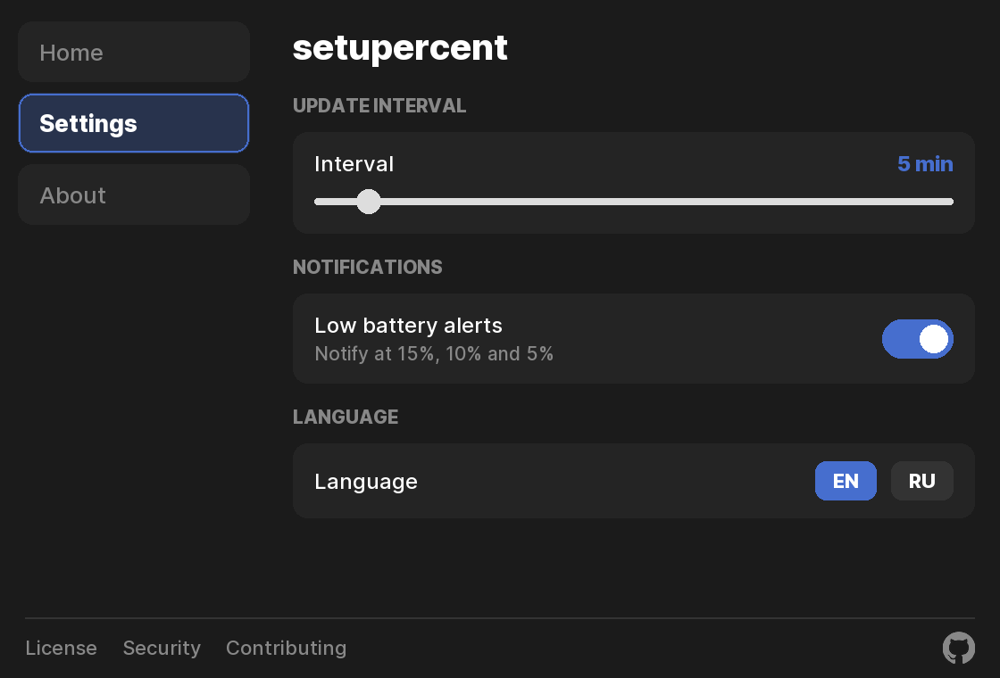

  

  
  

Утилита для системного трея Windows, которая всегда держит под рукой 
уровень заряда беспроводных мышей, наушников и клавиатур.

## Зачем это нужно

Беспроводная мышь разряжается в самый неподходящий момент. Наушники «умирают» посреди созвона. Клавиатура отключается, когда вы уже набираете текст. Windows показывает заряд таких устройств разве что в «Параметрах Bluetooth» — и то не всегда и не для всех.

setupercent решает эту проблему: он кладёт процент заряда прямо в трей и обновляет его в фоне. Один взгляд на панель задач — и вы знаете, когда пора поставить устройство на зарядку.

## Как это выглядит

  

<em>Устройство выбрано — процент заряда отображается в трее</em>

  

<em>Можно отслеживать несколько устройств и переключаться между ними</em>

  

<em>Настройка интервала обновления и языка интерфейса во вкладке «Настройки»</em>

## Что умеет

- **Заряд в трее** — цифра прямо на иконке, всегда на виду, без лишних кликов.
- **Работает с любыми беспроводными устройствами**, которые сообщают заряд системе: мыши, наушники, клавиатуры, геймпады.
- **Несколько устройств** — выберите в списке те, за которыми хотите следить, и переключайтесь между ними.
- **Удобная навигация** — боковое меню с разделами «Главная», «Настройки» и «О проекте».
- **Настраиваемый интервал** — от 1 до 60 минут, чтобы не дёргать систему зря.
- **Тихая работа** — окно скрывается в трей при закрытии, ничего не висит поверх других окон.
- **Русский и английский** — переключается в один клик в разделе «Настройки».
- **Лёгкая** — бинарник около 2 МБ, никаких фреймворков и веб-вью, память почти не занимает.

## Как пользоваться

1. Запустите `setupercent.exe` — окно появится сразу, иконка появится в трее.
2. Отметьте на вкладке «Главная» устройства, за которыми хотите следить.
3. Перейдите в «Настройки», чтобы задать интервал обновления (например, 5 минут) и выбрать язык.
4. Закройте окно. Оно свернётся в трей, а процент заряда продолжит обновляться в фоне.
5. Чтобы открыть окно снова — кликните по иконке в трее. Выход — через контекстное меню иконки.

## Установка

Скачайте последнюю версию со страницы [Releases](https://github.com/jocray/setupercent/releases) и запустите — установка не требуется. Настройки сохраняются рядом с `.exe` в файле `setupercent.json`.

## Требования

- Windows 10 или 11 (x64)
- Устройство, которое сообщает уровень заряда через стандартный интерфейс Windows (большинство современных Bluetooth-мышей, наушников и клавиатур)

## Исходный код

Проект открыт — исходники, инструкция по сборке и вся история версий доступны в [репозитории на GitHub](https://github.com/jocray/setupercent). Если нашли баг или хотите предложить улучшение — открывайте issue.